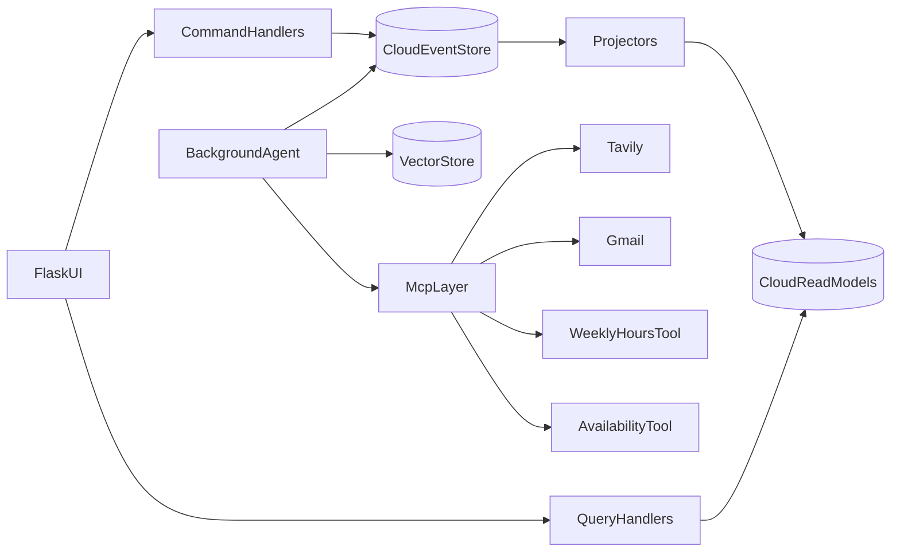
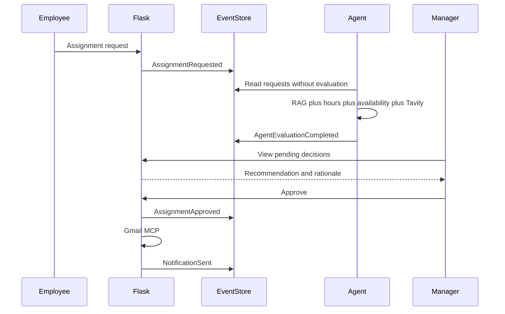

# System Architecture
## Smart Shift Manager

| Field | Value |
|---|---|
| Document | System architecture |
| System | Smart Shift Manager |
| Version | 1.0 |
| Methodology | Specification-Driven Application Development (SDAD) |
| Status | Approved for design |
| Related | [requirements.md](requirements.md), [skills_and_rules.md](skills_and_rules.md), [specification.md](specification.md) |

This document describes how the system meets [requirements.md](requirements.md). Behavior and acceptance stay in the requirements document.

---

## 1. Architecture overview

The system has four deployable parts:

1. A Flask web application that serves screens, authenticates users, and accepts commands and queries.
2. A cloud SQL Server database on Somee that stores the event log and the read models.
3. A vector store that stores embeddings of employee profiles and labor-agreement clauses.
4. A Python agent process, `agent_worker`, that runs on its own cycle outside the HTTP server.

Commands append immutable events. Projectors turn those events into read models. Screens query read models only. The agent reads requests that still need a recommendation, calls retrieval and MCP tools, and appends one recommendation event. It does not approve a shift.



---

## 2. Flask application

The web application uses the application factory and Blueprints, following the adopted Flask skill described in [skills_and_rules.md](skills_and_rules.md).

| Blueprint | Responsibility |
|---|---|
| `auth` | Sign-in, session, role routing |
| `commands` | Validate and append events for shifts, constraints, requests, and manager decisions |
| `queries` | Read models for the board, shift card, dashboards, and pending decisions |
| `notifications` | Send email through Gmail MCP after a decision event |

Flask does not run the evaluation inside a request. Submitting a request returns as soon as `AssignmentRequested` or `SwapRequested` is stored.

Configuration comes from the environment: the Somee connection string, the session secret, and MCP credentials. Passwords are stored as hashes.

Suggested layout:

```text
app/
  __init__.py              # application factory
  auth/
  commands/
  queries/
  notifications/
  projections/
agent_worker.py
```

---

## 3. CQRS

The write side and the read side are separate.

### 3.1 Write side

A command handler:

1. Checks that the session role may issue the command.
2. Rebuilds the aggregate from its own events.
3. Rejects the command when a business rule fails. No event is stored.
4. Appends exactly one event with the next aggregate version.

Command handlers do not update read tables.

| Command | Actor | Event |
|---|---|---|
| `DefineShift` | Manager | `ShiftDefined` |
| `UpdateShift` | Manager | `ShiftUpdated` |
| `CancelShift` | Manager | `ShiftCancelled` |
| `SubmitAvailability` | Employee | `AvailabilityConstraintSubmitted` |
| `WithdrawAvailability` | Employee | `AvailabilityConstraintWithdrawn` |
| `RequestAssignment` | Employee | `AssignmentRequested` |
| `RequestSwap` | Employee | `SwapRequested` |
| `RecordAgentEvaluation` | Agent | `AgentEvaluationCompleted` |
| `ApproveAssignment` | Manager | `AssignmentApproved` |
| `RejectAssignment` | Manager | `AssignmentRejected` |
| `ApproveSwap` | Manager | `SwapApproved` |
| `RejectSwap` | Manager | `SwapRejected` |

Employee commands take `employee_id` from the session.

### 3.2 Read side

| Query | Read model | Actor |
|---|---|---|
| `GetShiftBoard` | `read_shift_board` | Both |
| `GetShiftDetails` | `read_shift_board` plus request rows | By permission |
| `SearchOpenShifts` | Same tables, filtered | Employee |
| `GetDashboardSummary` | `read_dashboard_counts` | Manager |
| `GetCandidatesPerShift` | `read_shift_candidates` | Manager |
| `GetMyRequests` | `read_my_requests` | Employee |
| `GetPendingDecisions` | `read_pending_decisions` | Manager |

Screen queries do not read the `events` table.

### 3.3 Projectors

A projector walks new events in ascending `event_id` order and updates read models. It stores the last processed `event_id` so a restart continues from that point. Deleting a read model and running the projector again from the start of the log restores the board. That satisfies NFR-5.

Read models:

- `read_shift_board` — one row per shift, with assigned count and computed status.
- `read_shift_candidates` — waiting requests by shift.
- `read_dashboard_counts` — counts for a date range.
- `read_my_requests` — one employee's requests and latest status.
- `read_pending_decisions` — requests that have a recommendation and no approval or rejection yet.
- `read_employee_hours` — approved hours by employee and week.

---

## 4. Event sourcing

The event store is the table `events` in SQL Server on Somee.

| Column | Meaning |
|---|---|
| `event_id` | Unique identifier, ascending processing order |
| `aggregate_type` | `Shift`, `AssignmentRequest`, `SwapRequest`, or `EmployeeAvailability` |
| `aggregate_id` | Entity identifier |
| `event_type` | Name from the catalog below |
| `payload_json` | Event body |
| `version` | Sequence number inside the aggregate |
| `occurred_at` | UTC server time |
| `actor_id` | User identifier or `agent` |

A unique constraint on `(aggregate_id, version)` stops two writers from committing the same version.

| Event | When it is appended |
|---|---|
| `ShiftDefined` | Manager created a shift |
| `ShiftUpdated` | Hours, role, headcount, or note changed |
| `ShiftCancelled` | Shift cancelled |
| `AvailabilityConstraintSubmitted` | Employee added or replaced a constraint |
| `AvailabilityConstraintWithdrawn` | Employee cancelled a constraint |
| `AssignmentRequested` | Employee requested assignment |
| `SwapRequested` | Employee requested a swap |
| `AgentEvaluationCompleted` | Agent finished an evaluation |
| `AssignmentApproved` | Manager approved an assignment |
| `AssignmentRejected` | Manager rejected an assignment |
| `SwapApproved` | Manager approved a swap |
| `SwapRejected` | Manager rejected a swap |
| `NotificationSent` | Email was sent |
| `NotificationFailed` | Email send failed |

Events are not updated and are not deleted. There is no current-state table that is edited in place. The visible shift is the projection of its events.

Users and password hashes are account records, not shift aggregates. They are required for sign-in and are not a substitute for the event log.

---

## 5. Vector database

The vector store is a separate component from SQL Server. Somee SQL Server holds events and read models. Embeddings are not stored in the employee table.

### 5.1 Documents

1. **Employee profile.** Role name, years of experience, skills, shift types already worked, free-text preferences, and operational manager notes.
2. **Agreement clauses.** Short policy documents: weekly cap, rest between shifts, role qualification, and holiday-eve rules. Each clause is its own document.

Date-specific constraints stay in the event log and in read models. They are exact facts. The agent uses both the exact facts and the retrieved passages.

### 5.2 Pipeline

1. On save, split the profile or clause into short paragraphs.
2. Embed each paragraph and store metadata: `employee_id` or `policy`, plus the document type.
3. At evaluation time, build a query from the shift, for example "busy evening shift, shift lead role, date with an exceptional event".
4. Retrieve the top 5 passages, limited to that employee and to policy clauses.
5. Pass those passages to the agent together with tool results.

A profile change deletes that employee's vectors and writes them again. A clause change does the same for that clause id.

If retrieval fails, the agent still records a `warning` with the rationale "Evaluation without semantic context" and continues with the deterministic tools. Board screens do not call the vector store.

---

## 6. AI agent

`agent_worker` is a separate Python process. The default cycle is 30 seconds.

Each cycle:

1. Select assignment and swap requests that have no `AgentEvaluationCompleted` event.
2. Mark each selected request `processing` with a run id so a second worker skips it.
3. Load shift details, retrieved profile and policy passages, date constraints, and approved assignments from the last 30 days. For a swap, load the replacement employee as well.
4. Call the availability tool, the weekly-hours tool, and Tavily.
5. Append one `AgentEvaluationCompleted` event.
6. Clear the processing mark.

A failure before the recommendation event leaves the request for the next cycle. The worker does not write a partial recommendation.

| Decision | Condition |
|---|---|
| `reject` | Overlap, rest under 8 hours, `unavailable`, or role mismatch |
| `warning` | Otherwise eligible, and hours would exceed 42, or `prefer not` applies, or Tavily reports a holiday or exceptional event |
| `approve` | Eligible, and no warning condition applies |

The rationale is English, at most 500 characters, and includes the hour figures returned by the hours tool.

The agent does not append `AssignmentApproved` or `AssignmentRejected`, does not send email, and does not change headcount. Gmail runs in the Flask notification component after the manager's decision.

---

## 7. MCP tools

The agent and Flask reach tools through MCP. Tavily and Gmail are external servers. `calculate_weekly_hours` and `check_availability_conflicts` are project tools built in MCP Studio.

| Tool | Caller | Input | Output | Failure behavior |
|---|---|---|---|---|
| Tavily | Agent, every evaluation | Date and locality, or "Israel" | Whether a holiday or event was found, a short title, and a source | Continue without holiday data and say so in the rationale |
| Gmail | Flask notifications, after a decision | Employee address, subject, English body | Send result | Append `NotificationFailed`. Keep the decision |
| `calculate_weekly_hours` | Agent | `employee_id`, `week_start`, `additional_shift_hours` | `approved_hours`, `projected_hours`, `weekly_limit` (42), `exceeds_limit`, `overflow_hours` | Leave the request for the next cycle |
| `check_availability_conflicts` | Agent, and the swap form before submit | `employee_id`, `shift_date`, `start_time`, `end_time` | `hard_block`, `soft_block`, `reasons`, optional `conflicting_shift_id` | Leave the request for the next cycle when the agent called it |

Both project tools read read models only. They do not append events. They are not exposed as browser actions.

Every tool returns `ok` plus a body, or `error_code`. The recommendation records which tools ran and what they returned, without secrets and without the full email body.

---

## 8. Main assignment flow



The assigned count on the board changes when the projector handles `AssignmentApproved`.

---

## 9. Deployment and trust boundaries

| Part | Where it runs | What it may write |
|---|---|---|
| Flask web | Application host | Events for user commands and notification results |
| Projector | Same host as Flask, or a worker loop | Read models only |
| `agent_worker` | Separate process | `AgentEvaluationCompleted` only |
| SQL Server | Somee | Events and read models |
| Vector store | Separate store | Embeddings |
| Tavily and Gmail | External MCP servers | Nothing in the event store except through Flask or the agent |

The browser talks only to Flask. Employees do not receive manager query results. Tool credentials stay on the server.

Display times are converted to Israel time at the edge. `occurred_at` remains UTC.

---

## 10. Consistency rules

- One aggregate version is committed once.
- One request receives one recommendation.
- Read models may lag by one projector cycle. The screen shows the last successful projection, not a live fold of `events`.
- Notification failure is visible as `NotificationFailed` and does not roll back approval.
- Vector-store failure degrades the recommendation to a warning and does not hide the board.
