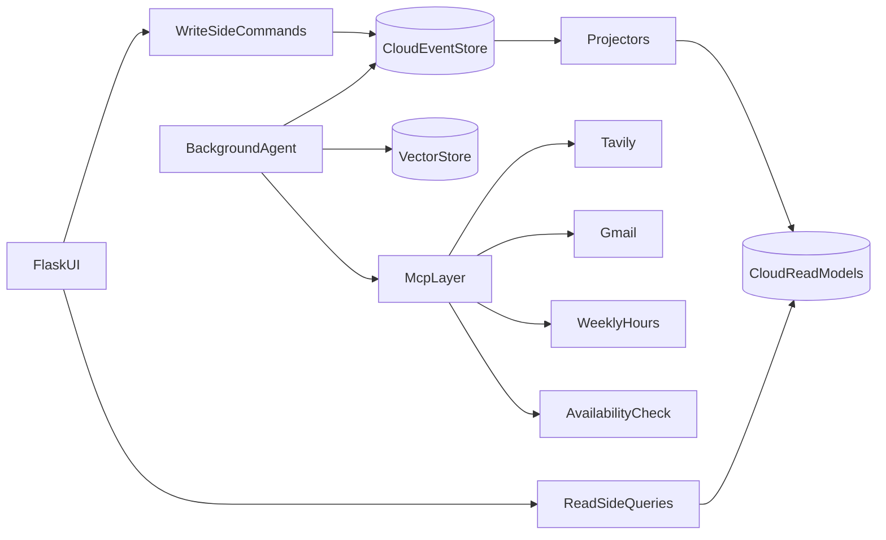
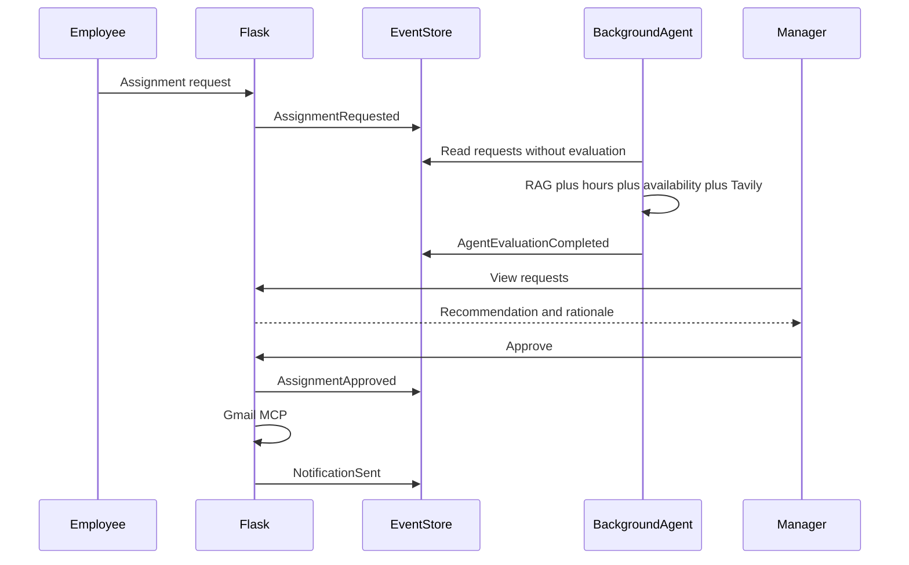

# System Specification
## Smart Shift Manager — Shift Management and Scheduling System

| Field | Value |
|---|---|
| System name | Smart Shift Manager |
| Specification version | 1.0 |
| Methodology | Specification-Driven Application Development (SDAD) |
| Stack | Python, Flask, cloud SQL Server (Somee), vector store, autonomous AI agent, MCP |
| Interface language | English |
| Status | Specification for approval before development |

This document defines the shift management and scheduling system. It is based on the assignment requirements summary and on the system description in the project. A separate official requirements document was not included in the project folder when this version was written.

---

## 1. Summary

Smart Shift Manager is a shift management system for a service organization. The shift manager defines shifts, views the board, and approves or rejects assignments. An employee enters availability constraints, submits an assignment or swap request, and searches for open shifts.

Every change is stored as an immutable event. Screens read from separate read models. An AI agent runs as an independent background process, reads requests from the database, combines semantic search over employee profiles and the labor agreement, and calls MCP tools. The agent returns a recommendation to the manager: approve, reject, or warn about an hours overrun. The final decision stays with the manager.

---

## 2. Goals

1. Keep the shift board, constraints, assignment requests, and swap requests in one system.
2. Give the manager a status picture: how many shifts are staffed, how many are open, and how many candidates registered for each shift.
3. Give the employee a search for an open shift by date or role, and a way to submit a request on one screen.
4. Produce an automatic assignment recommendation that takes availability, experience, history, weekly hours, and special events on the date into account.
5. Implement the required architecture: CQRS, Event Sourcing, Deep Agent, RAG, and MCP.

---

## 3. Scope

### 3.1 In scope

- Two user roles: shift manager and employee.
- Shift definition, weekly and monthly board, and shift card.
- Search and table display.
- Constraint entry, assignment request, and swap request.
- Dashboard of shift status and candidates.
- Autonomous evaluation agent.
- Semantic retrieval (RAG) over the employee profile and the labor agreement.
- Event log and separate read models in a cloud database.
- Four MCP tools: Tavily, Gmail, weekly hours calculation, and availability-constraint cross-check.

### 3.2 Out of scope

- Payroll calculation, biometric attendance, and recruitment.
- A separate mobile application. The interface is adapted to a desktop browser and to a narrow screen.
- Automatic assignment approval without a manager decision.
- Multiple branches with cross-organization permissions. The system manages one branch.

---

## 4. Users

### 4.1 Shift manager (scheduler)

Responsible for staffing the board.

Can:

- Define, update, and cancel a shift.
- View the weekly and monthly board and the dashboard.
- Accept or reject an assignment or swap request.
- Read the agent recommendation and its rationale.

Cannot:

- Change an event that has already been stored.
- Bypass the overlapping-shift check.

### 4.2 Employee (assignee)

Submits availability and requests.

Can:

- Enter availability constraints and preferences.
- Search for an open shift by date or role.
- Submit an assignment request for an open shift.
- Submit a swap request for a shift they are assigned to.
- View their own requests, the status of those requests, and the shifts approved for them.

Cannot:

- Approve an assignment for themselves or for another employee.
- See another employee's full profile or constraints.

### 4.3 Evaluation agent

Not a human user. A background process with a service identity.

It can read requests, profiles, board events, and MCP tools, and it can write a recommendation event only. It does not approve or reject an assignment.

---

## 5. Business rules

| ID | Rule |
|---|---|
| BR-1 | A shift is defined by a date, start time, end time, required role, and required headcount. The end time is later than the start time on the same day, or it crosses midnight explicitly. |
| BR-2 | Shift status on the board: open (0 assigned), partial (some assigned and some still missing), staffed (headcount reached), cancelled. |
| BR-3 | An employee is not assigned to two overlapping shifts. |
| BR-4 | At least 8 hours of rest are required between the end of one shift and the start of the next shift for the same employee. |
| BR-5 | Default weekly hours cap: 42. An overrun produces a warning, not an automatic rejection. |
| BR-6 | An employee can request assignment only to a shift in open or partial status, and only if their role matches the required role. |
| BR-7 | A swap is possible only between two employees on a future shift that both are qualified for, and only after an explicit request. |
| BR-8 | The agent recommendation is information for the manager. An assignment takes effect only after manager approval. |
| BR-9 | A constraint of type "unavailable" on a date blocks an approve recommendation. A constraint of type "prefer not" produces a warning. |
| BR-10 | A stored event is not deleted and is not edited. A correction is made by a new event. |

A work week is defined from Sunday 00:00 through Saturday 23:59, Israel time.

---

## 6. Use cases

### UC-1 Sign in

- **Actor:** manager or employee
- **Precondition:** the user has an active account
- **Flow:** enter email and password, identify the role, route to the matching dashboard
- **Exception:** wrong credentials. The system shows a failure message without saying which field is wrong

### UC-2 Define a shift

- **Actor:** manager
- **Input:** date, start, end, role, required headcount, optional note
- **Result:** the `ShiftDefined` event is stored. The board shows an open shift
- **Exception:** a date in the past, invalid hours, or a required headcount below 1. The command is rejected and no event is stored

### UC-3 Search and display the board

- **Actor:** manager or employee
- **Input:** a date range, and optionally a role and a status
- **Result:** a table. Selecting a row opens the shift details
- **Employee:** the "open shift" search shows only open or partial shifts the employee is qualified for

### UC-4 Enter a constraint

- **Actor:** employee
- **Input:** a date or a range, a type (`unavailable` / `prefer` / `prefer not`), a note
- **Result:** `AvailabilityConstraintSubmitted` is stored. The constraint is available to the agent and to the manager in the context of that employee's requests

### UC-5 Assignment request

- **Actor:** employee
- **Precondition:** the shift is open or partial, and it does not overlap a shift already approved for the employee
- **Result:** `AssignmentRequested` is stored with status waiting for evaluation
- **Continuation:** the agent writes a recommendation. The manager approves or rejects

### UC-6 Swap request

- **Actor:** requesting employee
- **Input:** their shift, the replacement employee, or an open request the replacement accepted
- **Result:** `SwapRequested` is stored. After an agent recommendation and manager approval, the original assignment is replaced and the board is updated

### UC-7 View the dashboard

- **Actor:** manager
- **Result:** the number of open, partial, and staffed shifts in the selected range, and a list of shifts with the number of waiting candidates for each one

### UC-8 Agent evaluation of a request

- **Actor:** evaluation agent
- **Precondition:** a request exists without an `AgentEvaluationCompleted` event
- **Result:** a recommendation event with one of the decisions `approve`, `reject`, or `warning`, a short rationale, and the sources used for the decision (MCP tools and RAG passages)

### UC-9 Approve or reject

- **Actor:** manager
- **Precondition:** an agent recommendation exists. The manager may decide against the recommendation, and the decision is stored with the manager's note
- **Assignment approval:** if BR-3 is not violated, `AssignmentApproved` is stored and the assigned count increases
- **Rejection:** `AssignmentRejected` is stored. The employee sees the status

### UC-10 Email notification

- **Actor:** the system, through Gmail MCP
- **Trigger:** approval, rejection, or a shift change that affects an employee
- **Result:** `NotificationSent` or `NotificationFailed` is stored. A send failure does not cancel the decision

---

## 7. Functional requirements

### 7.1 Search and table display

**FR-1.** The shift board is displayed as a table in two modes: week (Sunday–Saturday) and month.

Required columns:

- Date and weekday
- Hours
- Role
- Assigned / required
- Status
- Number of waiting candidates

**FR-2.** Filter by start date, end date, role, and status. An open-shift search filters to open or partial status.

**FR-3.** Selecting a row opens a shift card: the shift definition, the approved assignees, the waiting requests, and the agent recommendation for each request. An employee sees assignees on the card by first name and role only, without recommendations about other employees.

**FR-4.** An empty table shows the message "No shifts in the selected range" and a link to widen the range. The manager also sees a shortcut to define a shift.

### 7.2 Data entry

**FR-5.** The constraint form stores a date or a range, a constraint type, and a note of up to 300 characters.

**FR-6.** An assignment request opens from an open shift card and includes an optional employee note.

**FR-7.** A swap request includes the shift offered for swap and the replacement employee. If the replacement is unavailable according to their constraints, the form shows the block before submission.

**FR-8.** After a successful submission the system shows a request number and the status "Waiting for agent evaluation".

### 7.3 Dashboard

**FR-9.** The manager dashboard, for a default range of the next 7 days, shows:

- Open shifts
- Partial shifts
- Staffed shifts
- Requests waiting for a manager decision
- Requests still waiting for the agent

**FR-10.** The dashboard table shows, for each unstaffed shift, the number of candidates who registered and are waiting.

**FR-11.** The employee dashboard shows the shifts approved for them in the current week, the week's hour total, and their open requests.

### 7.4 Manager decision

**FR-12.** The pending-requests screen shows, for each request, the employee name, the shift, the request type (assignment or swap), the agent recommendation, the rationale, and an hours warning when one exists.

**FR-13.** Manager actions: approve, or reject with a note. Both actions are stored as events.

---

## 8. Architecture

Four separate components:

1. **Flask application** serves the screens, authenticates users, and accepts commands and queries.
2. **Cloud database (SQL Server on Somee)** stores the event log and the read models.
3. **Vector store** stores embeddings of employee profiles and labor-agreement clauses.
4. **Agent process** runs separately from the HTTP server, on a fixed cycle, and is not part of the browser request.

---

## 9. CQRS and Event Sourcing

### 9.1 Principle

A change command does not update the board table. It is validated, and if it is valid an event is stored. A projector reads new events and rebuilds the read tables. Screens read only from the read tables.

### 9.2 Event log

Table `events`:

| Column | Meaning |
|---|---|
| event_id | Unique identifier |
| aggregate_type | `Shift`, `AssignmentRequest`, `SwapRequest`, `EmployeeAvailability` |
| aggregate_id | Entity identifier |
| event_type | Event name from the catalog below |
| payload_json | Event body |
| version | Sequence number within the same aggregate |
| occurred_at | Server time in UTC |
| actor_id | User or `agent` |

A uniqueness constraint on `(aggregate_id, version)` prevents two concurrent writes of the same version.

### 9.3 Event catalog

| Event | When it is stored |
|---|---|
| `ShiftDefined` | A manager created a shift |
| `ShiftUpdated` | Hours, role, headcount, or note changed |
| `ShiftCancelled` | A shift was cancelled |
| `AvailabilityConstraintSubmitted` | An employee added or replaced a constraint |
| `AvailabilityConstraintWithdrawn` | An employee cancelled a constraint |
| `AssignmentRequested` | An employee requested an assignment |
| `SwapRequested` | An employee requested a swap |
| `AgentEvaluationCompleted` | The agent finished an evaluation |
| `AssignmentApproved` | A manager approved an assignment |
| `AssignmentRejected` | A manager rejected an assignment |
| `SwapApproved` | A manager approved a swap |
| `SwapRejected` | A manager rejected a swap |
| `NotificationSent` | An email was sent |
| `NotificationFailed` | Sending an email failed |

### 9.4 Commands (write side)

| Command | Who | Event stored |
|---|---|---|
| `DefineShift` | Manager | `ShiftDefined` |
| `UpdateShift` | Manager | `ShiftUpdated` |
| `CancelShift` | Manager | `ShiftCancelled` |
| `SubmitAvailability` | Employee | `AvailabilityConstraintSubmitted` |
| `WithdrawAvailability` | Employee | `AvailabilityConstraintWithdrawn` |
| `RequestAssignment` | Employee | `AssignmentRequested` |
| `RequestSwap` | Employee | `SwapRequested` |
| `RecordAgentEvaluation` | Agent | `AgentEvaluationCompleted` |
| `ApproveAssignment` | Manager | `AssignmentApproved` |
| `RejectAssignment` | Manager | `AssignmentRejected` |
| `ApproveSwap` | Manager | `SwapApproved` |
| `RejectSwap` | Manager | `SwapRejected` |

A command is validated against the aggregate state, which is rebuilt from that aggregate's event sequence, before the write.

### 9.5 Queries (read side)

| Query | Source | Who |
|---|---|---|
| `GetShiftBoard` | `read_shift_board` | Both |
| `GetShiftDetails` | `read_shift_board` plus requests | By permission |
| `SearchOpenShifts` | The same tables, filtered | Employee |
| `GetDashboardSummary` | `read_dashboard_counts` | Manager |
| `GetCandidatesPerShift` | `read_shift_candidates` | Manager |
| `GetMyRequests` | `read_my_requests` | Employee |
| `GetPendingDecisions` | `read_pending_decisions` | Manager |

Queries do not read the `events` table while a screen is being displayed.

### 9.6 Read models

- `read_shift_board` — one row per shift, including the assigned count and the computed status.
- `read_shift_candidates` — waiting requests by shift.
- `read_dashboard_counts` — aggregation for a date range.
- `read_my_requests` — an employee's requests and the latest status.
- `read_pending_decisions` — requests that have an agent recommendation and still have no approval or rejection.
- `read_employee_hours` — approved hours by employee and week, for the tool and for the employee dashboard.

The projector processes events by ascending `event_id` and stores the last processed identifier so it can resume after a restart.

---

## 10. Evaluation agent (Deep Agent)

### 10.1 Runtime shape

The agent is a separate Python process (`agent_worker`). It does not run inside a Flask request.

On every cycle, by default every 30 seconds:

1. It looks for assignment or swap requests that have no `AgentEvaluationCompleted`.
2. It locks each request for processing with a `processing` mark and a run identifier, so two processes do not evaluate it twice.
3. It gathers context, runs the tools, and writes one recommendation event.
4. It releases the lock. A failure in the middle of the cycle leaves the request for the next attempt, without a partial recommendation event.

### 10.2 Evaluation input

For each request the agent loads:

- Shift details: date, hours, role, and how many people are still missing.
- The employee profile from semantic retrieval: experience, preferences, and relevant agreement limits.
- The employee's availability constraints on that date.
- The employee's approved assignment history for the last 30 days, from the read model.
- For a swap request: the same data for the replacement employee as well.

### 10.3 Tools the agent must call

Before a decision, on every evaluation:

1. **Availability cross-check** — whether there is a blocking constraint or an overlap.
2. **Weekly hours calculation** — approved hours in that week plus the hours of the requested shift.
3. **Tavily** — whether the date is a holiday eve, a holiday, or a special event that requires heavier staffing. A positive result is recorded in the rationale and does not reject by itself.

Gmail is not part of the evaluation. It is called after the manager's decision.

### 10.4 Decisions

| Decision | When |
|---|---|
| `reject` | Overlapping shifts, fewer than 8 hours of rest, an "unavailable" constraint, or a role mismatch |
| `warning` | The request is eligible, and a overrun above 42 hours is expected, or a "prefer not" constraint exists, or a holiday or exceptional event was found |
| `approve` | The request is eligible and there is no warning |

The rationale is a short English text, up to 500 characters, and it includes the numbers returned by the tools (accumulated hours, shift hours).

### 10.5 What the agent does not do

The agent does not write `AssignmentApproved` or `AssignmentRejected`. It does not send email. It does not change the shift headcount.

---

## 11. RAG and vector store

### 11.1 What is stored as a vector

Two document types:

1. **Employee profile** — role name, years of experience, skills, types of shifts performed, free-text preferences the employee entered, and operational manager notes.
2. **Agreement and limits** — short clauses: hours cap, rest between shifts, role qualification, holiday-eve rules. Each clause is a separate document.

Date-specific constraints are stored in the event log and in the read model, because they are an exact fact and not text for semantic search. The agent combines both sources.

### 11.2 Pipeline

1. When a profile or agreement clauses are saved, the system splits them into short paragraphs.
2. Each paragraph receives an embedding and is stored with metadata: `employee_id` or `policy`, and the document type.
3. During evaluation a query is built from the shift, for example: "busy evening shift, shift lead role, date with an exceptional event".
4. A top-5 search runs, filtered to the requested employee and to the agreement clauses.
5. The retrieved passages enter the agent context together with the tool results.

### 11.3 Updates

A profile change deletes the vectors for that `employee_id` and writes them again. Agreement clauses are updated the same way by clause identifier. The board and the requests do not depend on vector-store availability for display. If retrieval fails, the agent records a `warning` recommendation with the rationale "Evaluation without semantic context" and continues according to the deterministic tools.

---

## 12. MCP

The agent and the Flask application reach tools through the MCP protocol. Two tools are external and two tools are developed in MCP Studio.

### 12.1 Tavily MCP

- **Use:** check holidays and special events on the shift date.
- **Input:** date, locality name, or "Israel".
- **Output to the agent:** whether a holiday or event was found, a short title, and a source.
- **Failure:** the agent continues without the holiday data and says so in the rationale.

### 12.2 Gmail MCP

- **Use:** notify an employee after approval, rejection, or cancellation of a shift that affects them.
- **Input:** employee address, subject, message body in English.
- **Who calls it:** the Flask notification component after a decision event, not the agent.
- **Failure:** `NotificationFailed` is stored. The decision stays in effect.

### 12.3 MCP Studio tool — weekly hours calculation

Name: `calculate_weekly_hours`

Input:

- `employee_id`
- `week_start` (Sunday)
- `additional_shift_hours` (hours of the requested shift)

Output:

- `approved_hours`
- `projected_hours`
- `weekly_limit` (42)
- `exceeds_limit` (yes/no)
- `overflow_hours`

The calculation reads `read_employee_hours` and adds the request hours. It does not write to the event log.

### 12.4 MCP Studio tool — availability constraint cross-check

Name: `check_availability_conflicts`

Input:

- `employee_id`
- `shift_date`
- `start_time`
- `end_time`

Output:

- `hard_block` — an "unavailable" constraint, an overlap, or rest shorter than 8 hours
- `soft_block` — a "prefer not" constraint
- `reasons` — a list of short sentences
- `conflicting_shift_id` when there is an overlap

The tool reads read models only.

### 12.5 Shared contract for every tool

Every tool returns `ok` and a result body, or `error_code`. The agent records in the recommendation field which tools ran and what came back, without storing secrets or the full email body.

---

## 13. Logical data model

Beyond the event log:

**User** — identifier, full name, unique email, password as a hash, role (`manager` / `employee`), professional role (for example shift lead, representative), active or inactive.

**Embedding profile** — profile text, last update time. The vectors live in the vector store, not in the employee table.

**Read models** — as specified in section 9.6. They can be rebuilt from the event log.

There is no "current state" table that is edited in place. The current state of a shift is the product of projection.

---

## 14. Screens

| Screen | User | Content |
|---|---|---|
| Sign in | Everyone | Email and password |
| Manager dashboard | Manager | Counts, table of open shifts and candidates |
| Shift board | Everyone | Weekly/monthly table and filters |
| Shift card | Everyone | Details, assignees, and requests by permission |
| Define shift | Manager | Create and edit form |
| Requests for decision | Manager | Agent recommendation, approve or reject |
| My dashboard | Employee | Approved shifts, weekly hours, requests |
| Constraints | Employee | Entry form and list of existing constraints |
| Search open shift | Employee | Date and role filter, submit a request |
| Swap request | Employee | Choose an approved shift and a replacement employee |

Manager navigation: dashboard, board, requests. Employee navigation: my shifts, search, constraints.

Every form shows a validation error next to the field. After a successful action a success message appears with the new status.

---

## 15. Main flow

The board updates when the projector processes `AssignmentApproved`. Until then the count in the table does not change.

---

## 16. Non-functional requirements

| ID | Requirement |
|---|---|
| NFR-1 | The interface is in English |
| NFR-2 | Passwords are stored as a hash. The database connection string and MCP secrets live in environment variables, not in code |
| NFR-3 | An employee does not reach manager routes. Role is checked on every command and every query |
| NFR-4 | An agent failure or an email failure does not block viewing the board or submitting a request |
| NFR-5 | All read models can be rebuilt from the event log |
| NFR-6 | Display times are shown in Israel time. The log is stored in UTC |
| NFR-7 | The agent run log includes the request identifier and the decision, without the full profile body and without email content |

---

## 17. Security and permissions

- Sign-in is session-based after authentication.
- Every command checks that the signed-in user has the role allowed to issue it.
- An employee submits a request only with their own `employee_id`. The identifier is taken from the session, not from the form.
- The hours tool and the availability tool are available to the agent. They are not exposed as a free action from the employee's browser.
- User deactivation is a future `UserDeactivated` event. In this version an inactive account cannot sign in, and its event history remains.

---

## 18. Traceability to the assignment

| Requirement | How the system answers it | Sections |
|---|---|---|
| Two user types: manager and employee | Separate roles, screens, and permissions | 4, 14, 17 |
| Search and table display | Weekly/monthly board, filter by date and role, shift card | 7.1, UC-3 |
| Data entry | Constraint, assignment request, swap request | 7.2, UC-4–UC-6 |
| Dashboard | Open versus staffed, and candidates per shift | 7.3, UC-7 |
| Autonomous Deep Agent | Background process that reads requests from the database and writes a recommendation | 10 |
| RAG and vector store | Profile, experience, preferences, and agreement as embeddings, semantic search for a shift | 11 |
| CQRS and Event Sourcing | Commands versus queries, cloud event log, read models | 9 |
| Flask and cloud database | Flask server, SQL Server on Somee | 8, 9 |
| External MCP | Tavily for holidays and events, Gmail for notifications | 12.1, 12.2 |
| Two MCP Studio tools | Weekly hours calculation and constraint cross-check | 12.3, 12.4 |

---

## 19. Acceptance criteria

1. A manager defines a shift and it appears on the board as open, after the event is stored and the projector runs.
2. An employee filters open shifts by date and role and submits a request. The request appears for them as waiting.
3. Without the agent, the request is not approved. After an agent cycle a recommendation with a rationale appears.
4. A request that overlaps an approved shift receives `reject`. A request that takes the week above 42 hours receives `warning` and reaches the manager.
5. Manager approval increases the assigned count on the dashboard and in the table, and rejects a further request that would create an overlap.
6. The manager dashboard shows open, partial, and staffed shifts separately, and the number of candidates for each open shift.
7. The board query reads from the read model. Manually deleting the read model and rebuilding it from the events restores the same board.
8. On a holiday date, the agent rationale includes the finding that came from Tavily.
9. After approval a notification is sent to the employee, or a send failure is recorded without cancelling the approval.
10. An employee who tries to open the manager decision screen is refused.

---

## 20. Assumptions

The following assumptions are specification decisions. If the official requirements document states otherwise, these are the sections to align:

- One branch, two human roles.
- A 42-hour cap produces a warning only, not a block.
- A minimum rest of 8 hours, and that is a block.
- The manager always decides. The agent only recommends.
- The cloud relational database is SQL Server on Somee. The vector store is a separate component.
- The interface language is English.
